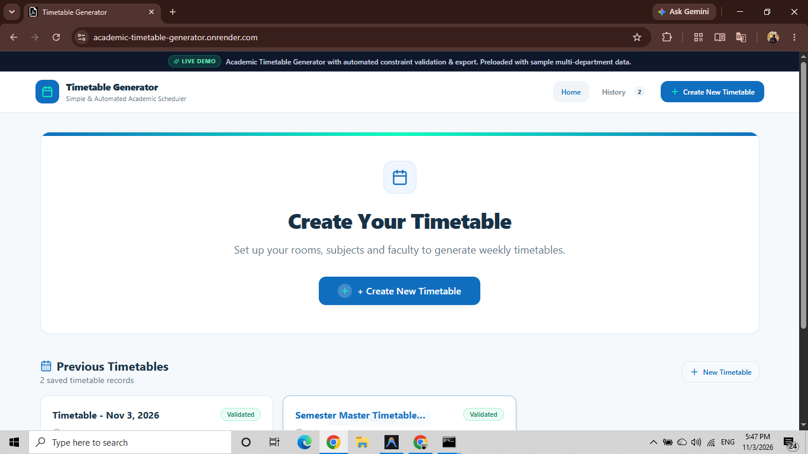
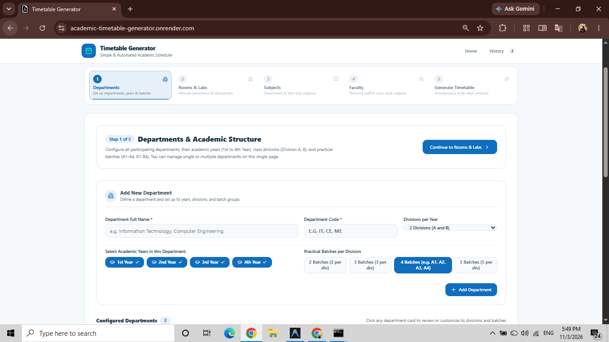
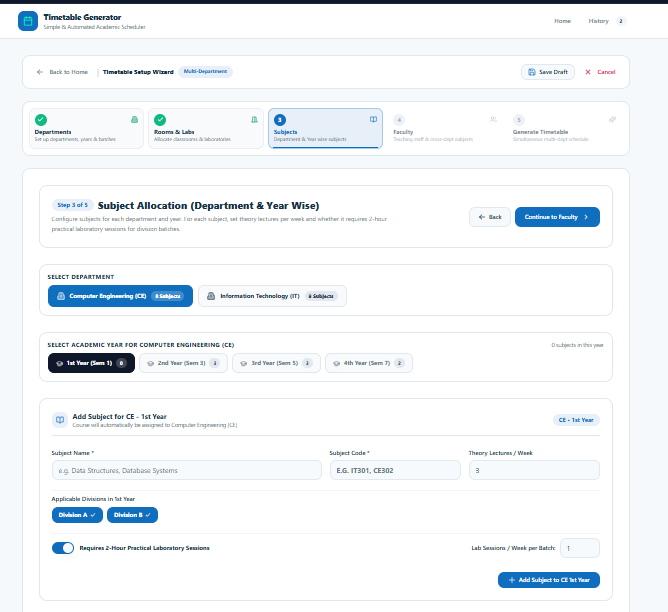
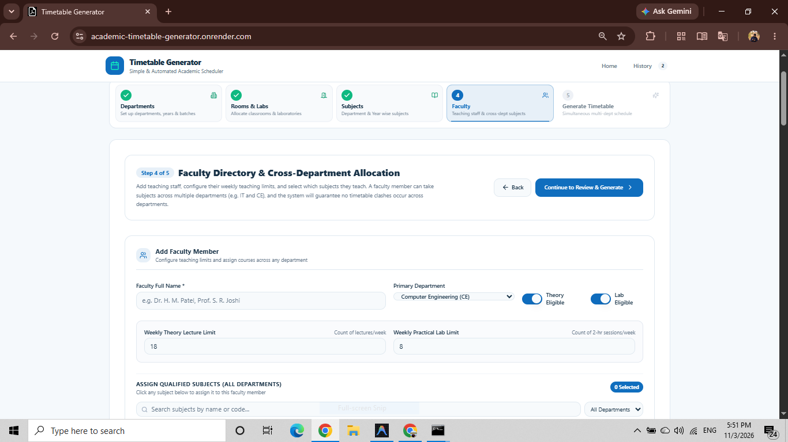
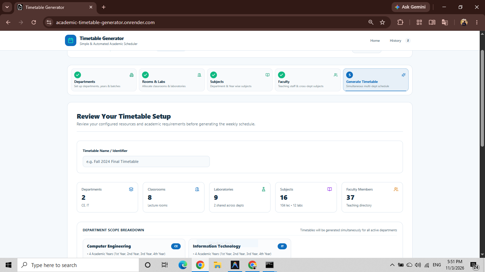

# Academic Timetable Generator

**A Web-Based Academic Scheduling and Timetable Generation System**

  
  
  

## Live Demo

**Explore the deployed application:**

https://academic-timetable-generator.onrender.com

The application is deployed on Render and runs in Demo Mode with synthetic academic data.

---

## Project Overview

Academic Timetable Generator is a web-based application designed to simplify academic timetable preparation and management.

The system provides a structured workflow for configuring departments, classrooms, laboratories, subjects, and faculty before generating academic timetables.

It also includes timetable validation to help identify scheduling conflicts and improve academic resource allocation.

## Key Features

- Department configuration and management
- Classroom and laboratory configuration
- Subject management
- Faculty management and allocation
- Step-by-step timetable generation workflow
- Automated academic scheduling
- Timetable conflict validation
- Theory and practical session scheduling
- Department-wise timetable organization
- Demo Mode for public access

## Application Workflow

The application follows a structured five-step timetable generation process.

1. Configure Departments
2. Configure Rooms and Laboratories
3. Add Subjects
4. Manage Faculty
5. Generate Timetable

---

## Screenshots

Explore the application interface and its timetable generation workflow.

### 1. Dashboard

The main dashboard provides access to the application's academic timetable management features.

### 2. Department Configuration

Configure academic departments and their related information.

### 3. Rooms and Laboratories

Manage classrooms and laboratory resources for academic scheduling.

### 4. Subject Management

Configure subjects required for timetable generation.

### 5. Faculty Management

Manage faculty information and academic teaching assignments.

### 6. Generate Timetable

Generate academic timetables using the configured departments, rooms, subjects, and faculty.

---

## Technology Stack

### Frontend
- React
- TypeScript
- Vite
- Tailwind CSS

### Backend
- Node.js
- Native HTTP Server
- JSON-based data storage

### Deployment and Version Control
- Git
- GitHub
- Render

## Demo Environment

The public application uses synthetic demonstration data.

| Information | Details |
|---|---|
| Institution | Academic Institute Demo |
| Departments | CE and IT |
| Sample Timetable Sessions | 152 |
| Environment | Production |
| Application Mode | Demo Mode |
| Hosting Platform | Render |

The live demo is intended for exploration and testing. Server-side data modifications are restricted in Demo Mode.

## Project Objectives

- Simplify academic timetable preparation.
- Organize departments, subjects, rooms, and faculty.
- Support structured timetable generation.
- Help identify scheduling conflicts.
- Provide an accessible web-based academic scheduling interface.

## Source Code

The complete application source code is maintained in a separate private GitHub repository.

This public repository is intended for project presentation, documentation, screenshots, and live demonstration.

## Live Application

**Try the Academic Timetable Generator:**

https://academic-timetable-generator.onrender.com

---

  <strong>Academic Timetable Generator</strong> 
  Academic Software Project

